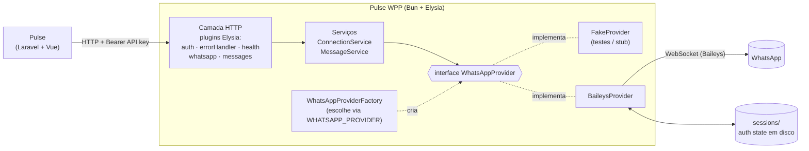
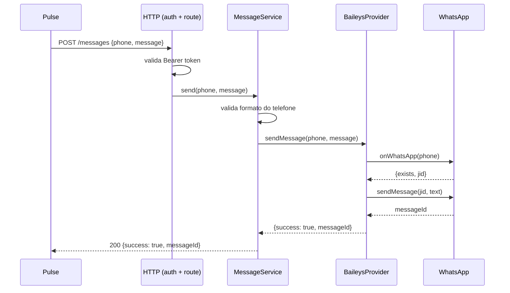

# Pulse WPP

Gateway HTTP de WhatsApp para o **Pulse** (CRM em Laravel + Vue + Inertia). Um serviço independente, em Bun + Elysia + TypeScript, que cuida só da comunicação: conectar uma conta via QR Code, manter a sessão, enviar mensagens e reportar o resultado. A lógica comercial (leads, campanhas, fila) fica no Pulse.


## O problema

O Pulse só conseguia abrir links `wa.me`: o usuário clicava, o WhatsApp abria com a mensagem pronta e ele mesmo apertava "enviar", um lead por vez. Isso impede campanhas com vários contatos.

O objetivo é que o Pulse dispare mensagens automaticamente, sem misturar o CRM com os detalhes de uma biblioteca de WhatsApp (que muda, quebra e pode ser trocada pela API oficial da Meta no futuro).

```text
Antes:  Lead → Pulse → abre wa.me → usuário envia manualmente
Depois: Lead → Campanha → Fila (Pulse) → Pulse WPP → WhatsApp
```

**Responsabilidade do Pulse WPP:** conexão, QR Code, persistência da sessão, status, envio e resultado do envio.
**Fora do escopo (fica no Pulse):** leads, templates, campanhas, fila, intervalo entre envios, histórico.

## Arquitetura



Fluxo de um envio (`POST /messages`):



Estados da conexão: `disconnected → connecting → qr_required → connected`, com `logged_out` quando a sessão é encerrada pelo celular.

### Estrutura

```text
src/
├── index.ts              # composition root: config → provider → services → app
├── config/env.ts         # validação de env (falha rápido no boot)
├── logger.ts             # pino
├── http/                 # plugins Elysia: auth, errorHandler, health, whatsapp, messages
└── whatsapp/
    ├── errors.ts         # erros de domínio
    ├── phone.ts          # checagem de formato do telefone
    ├── providers/        # WhatsAppProvider (interface), Baileys, Fake, Factory, contract tests
    └── services/         # ConnectionService, MessageService
```

## Decisões técnicas

- **Provider agnóstico.** Toda a aplicação depende da interface `WhatsAppProvider`, nunca do Baileys. Trocar de biblioteca (ou ir para a API oficial) é criar uma nova implementação e registrá-la na `WhatsAppProviderFactory`.
- **Testes de contrato.** `WhatsAppProvider.contract.ts` define a suíte que qualquer provider precisa passar; `FakeProvider` e `BaileysProvider` rodam a mesma bateria. Um provider futuro não precisa de lógica de teste nova.
- **Gateway sem regra de negócio.** Fila, intervalos e campanhas ficam no Pulse. O serviço é pequeno e stateless do ponto de vista do negócio; o único estado é a sessão do WhatsApp.
- **Resiliência.** Queda transitória reconecta sozinha, sem pedir QR de novo; `logged_out` é tratado de forma distinta (exige novo QR); erros de socket fora do ciclo de uma requisição são capturados (`uncaughtException`/`unhandledRejection`) e nunca derrubam o servidor HTTP.
- **Contrato de erro estável.** Todo erro vira `{ success: false, error: { code, message } }` com códigos fixos (`UNAUTHORIZED`, `INVALID_REQUEST`, `WHATSAPP_NOT_CONNECTED`, `WHATSAPP_AUTH_REQUIRED`, `MESSAGE_SEND_FAILED`, `PROVIDER_UNAVAILABLE`, `INTERNAL_ERROR`). Quem consome depende do `code`, não do texto.
- **Configuração validada no boot.** `loadConfig` acumula todos os problemas de env e falha de uma vez, em vez de quebrar tarde e um por um.
- **Logs estruturados** com pino e eventos nomeados (`QR_GENERATED`, `API_REQUEST`, `PROVIDER_ERROR`...).
- **Biome** para lint e formatação; diretrizes de código em [`docs/code-guidelines.md`](docs/code-guidelines.md).

### ADRs

Dois bugs reais de produção viraram decisões documentadas:

| ADR | Problema | Decisão |
|-----|----------|---------|
| [0001](docs/adr/0001-downgrade-baileys-to-6.17.16.md) | Na `7.0.0-rc14` do Baileys o QR vinha com prefixo `https://wa.me/settings/linked_devices#` e o app do celular ignorava o scan, sem nenhum erro. | Fixar na `6.x` estável até uma `7.x` ser validada com scan real. |
| [0002](docs/adr/0002-usar-jid-resolvido-pelo-onwhatsapp.md) | Números BR com 9º dígito retornavam `success: true`, mas a mensagem nunca chegava: o JID era reconstruído do telefone bruto. | Enviar para o `jid` que o `onWhatsApp()` resolveu e, se o número de 8 dígitos não for achado, tentar de novo com o 9 inserido. |

## Como rodar

Pré-requisito: [Bun](https://bun.sh).

```bash
bun install
cp .env.example .env     # preencha PULSE_WPP_API_KEY
bun run dev              # http://localhost:3000
```

| Variável | Descrição |
|----------|-----------|
| `APP_PORT` / `APP_HOST` | Porta e host do servidor |
| `WHATSAPP_PROVIDER` | `fake`, `baileys-stub` (comportamento do Baileys sem conexão real) ou `baileys` |
| `WHATSAPP_SESSION_PATH` | Onde a sessão fica salva (`./sessions`) |
| `PULSE_WPP_API_KEY` | Chave da API (alias: `PULSE_API_KEY`) |
| `LOG_LEVEL` | `fatal`, `error`, `warn`, `info`, `debug`, `trace`, `silent` |

### Conectando um número real

1. No `.env`: `WHATSAPP_PROVIDER=baileys`.
2. `POST /whatsapp/connect`
3. `GET /whatsapp/qr` devolve a string crua do QR; renderize e escaneie em *WhatsApp → Aparelhos conectados*. (O script `print-qr.mjs` ajuda a imprimir no terminal.)
4. `GET /whatsapp/status` deve retornar `connected` com o `phone`.

Detalhes em [`docs/whatsapp-connect-setup.md`](docs/whatsapp-connect-setup.md).

### API

Todas as rotas, exceto `/health`, exigem `Authorization: Bearer <PULSE_WPP_API_KEY>`.

| Método | Rota | Descrição |
|--------|------|-----------|
| GET | `/health` | Health check (público) |
| GET | `/whatsapp/status` | Status da conexão e telefone |
| GET | `/whatsapp/qr` | QR Code atual (`{ qr }`) |
| POST | `/whatsapp/connect` | Inicia a conexão |
| POST | `/whatsapp/disconnect` | Encerra a conexão |
| POST | `/messages` | Envia texto `{ phone, message }` |

```bash
curl -X POST http://localhost:3000/messages \
  -H "Authorization: Bearer $PULSE_WPP_API_KEY" \
  -H "Content-Type: application/json" \
  -d '{"phone":"5582999999999","message":"Olá!"}'
# {"success":true,"messageId":"3EB0..."}
```

Referência completa para quem consome: [`docs/pulse-integration.md`](docs/pulse-integration.md).

## Testes

```bash
bun test            # 80 testes, 14 arquivos
bun run typecheck   # tsc --noEmit
bun run lint        # biome check
```

- **Unitários** para config, auth, error handler, logger, serviços e rotas HTTP.
- **Contrato** (`*.contract.test.ts`): a mesma bateria roda contra `FakeProvider` e `BaileysProvider`.
- **Isolamento do Baileys** (`baileys-isolation.test.ts`): garante que a lib não vaza para fora da camada de provider.
- **Regressão** para os bugs das ADRs (JID resolvido, retry do 9º dígito).
- Nenhum teste depende de uma conexão real: o socket do Baileys é simulado.

Para testar a API manualmente com um cliente HTTP: [`docs/testing-with-yaak.md`](docs/testing-with-yaak.md).

## Documentação

[`docs/PRD.md`](docs/PRD.md) · [`docs/pulse-integration.md`](docs/pulse-integration.md) · [`docs/whatsapp-connect-setup.md`](docs/whatsapp-connect-setup.md) · [`docs/adr/`](docs/adr)

## Aviso

O Baileys usa o protocolo não oficial do WhatsApp Web. Use apenas com contas e contatos que você tem autorização para contatar; o uso pode violar os termos do WhatsApp e levar ao banimento do número.
